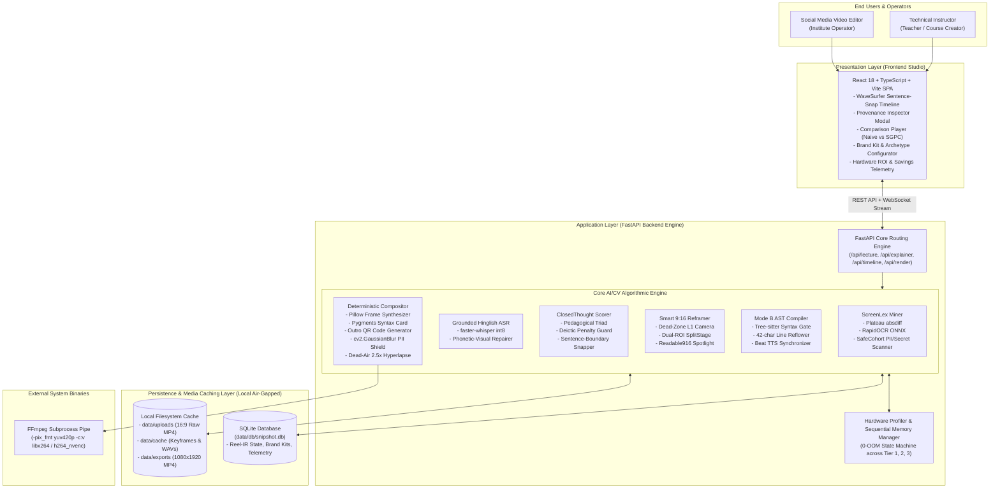
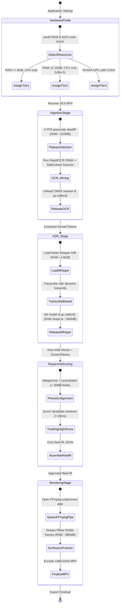
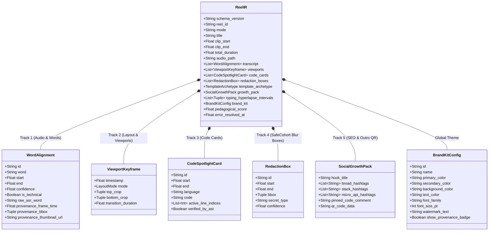

# SnipShot (Reel Studio): Flagship Architecture & Technical Blueprint

**Document Version:** 2.0.0  
**Status:** Canonical System Architecture & Business Model Blueprint  
**Classification:** Local-First Multimodal Pedagogical Video Studio (`SGPC`)  
**Target Platform:** Linux / macOS / Windows (Tier 1–3 CPU & GPU Profiles)  

---

## 1. Product Thesis & The 'Local-First Studio' Business Model

### A. The Core Economic & Architectural Paradox
Modern video editors, technical instructors, and coaching institutes (such as TechSummitTrainers) already own powerful, multi-core workstation laptops equipped with 14–18 CPU threads, 16GB+ RAM, and neural accelerators or GPUs. Yet, the current generation of automated clipping tools (`OpusClip`, `Vizard.ai`, `Descript`, `Klap.app`) forces them into an absurd operational model:

1. **Bandwidth Tax:** Uploading 90-minute 1080p/4K lecture recordings (3GB–8GB) over residential or campus internet to remote cloud servers.
2. **Recurring Per-Minute Cloud Tax:** Paying monthly subscriptions that ration video minutes with aggressive credit caps (e.g., $30–$80/month for only 150–300 minutes of exported video), where every timeline re-trim burns billable cloud credits.
3. **Privacy & Security Risk:** Pushing unreleased proprietary course curricula, student Zoom interactions, and exposed terminal credentials (`.env` files, API keys, database URLs) to third-party cloud multi-tenant storage.
4. **Pedagogical Failure:** Receiving generic face-centred crops that chop source code lines in half horizontally and output captions like `"use a fact"` or `"auto wired"`.

### B. The Local-First Perpetual Paradigm Shift
Professional video production tools disrupted software by refusing to charge monthly per-minute cloud rents, instead delivering a professional, hardware-accelerated local engine with an unbeatable community tier and a one-time perpetual Studio license.

**SnipShot** applies this exact local-first paradigm to AI-powered educational short-form video creation:
- **Zero Cloud Cost:** 100% of the speech recognition (`faster-whisper`), screen OCR (`RapidOCR`), syntax parsing (`tree-sitter`), and video composition (`Pillow + FFmpeg`) runs locally on the user's host machine.
- **Instant Turnaround:** Re-trimming timeline boundaries or switching Brand Kits re-renders a 45-second 1080×1920 Reel in **6–12 seconds** via multi-threaded CPU pipes, without waiting in a remote cloud GPU queue.
- **Total Air-Gapped Privacy:** Ingested media, extracted student interactions, and codebases never leave `localhost`.

```
+-------------------------------------------------------------------------------------------------------+
|                                    BUSINESS MODEL COMPARISON                                          |
|                                                                                                       |
|  Traditional Cloud Clipper SaaS (OpusClip / Vizard)       SnipShot (Local-First Studio Engine)        |
|  --------------------------------------------------       ------------------------------------        |
|  - Cloud Inference Cost: $0.12 - $0.25 / minute           - Cloud Inference Cost: ₹0.00 ($0.00)       |
|  - Gross Margins: 35% - 55% (Server heavy)                - Gross Margins: 92% - 96% (Software pure)  |
|  - Pricing: $30 - $120/mo recurring per editor            - Pricing: Hybrid Perpetual Studio License  |
|  - Video Privacy: Cloud Upload Required                   - Video Privacy: 100% On-Device Air-Gapped  |
|  - Re-render Time: 45s - 180s (Network + Queue)           - Re-render Time: 6s - 12s (Local Pipe)     |
+-------------------------------------------------------------------------------------------------------+
```

### C. Hybrid Perpetual Commercial Architecture
SnipShot operates on a three-tier commercial structure designed for institutes and solo creator-engineers:

1. **Community Free Tier (100% Local, Forever Free):**
   - Unlimited 1080×1920 exports with standard watermark.
   - Core `ScreenLex-ASR` vocabulary biasing and `SplitStage` Dual-ROI reframing.
   - Standard Brand Kit presets. Zero cloud dependencies.
2. **Studio Perpetual License (One-Time Payment — ₹14,999 / $199):**
   - Commercial license with watermark removal.
   - Full 10-Weapon Arsenal unlocked: `SafeCohort` secret redaction, custom institute Brand Kits, Outro QR code generation, and 4K/60fps rendering.
   - Lifetime local software access with 12 months of core algorithmic updates.
3. **Optional Annual Model & Template Pass (₹3,999/yr / $49/yr):**
   - Access to newly tuned Hinglish domain glossaries (AI/ML, DevOps, Rust, Web3).
   - Seasonal trend templates and viral hook archetype updates.
4. **Institute Enterprise Fleet Tier:**
   - Multi-seat volume licensing for coaching academies (TechSummitTrainers, CodeCampus) with centralized brand asset sync and on-premise OBS/Zoom batch folder watchers.

---

## 2. Deep Competitor Technical Comparison Matrix

The table below contrasts **SnipShot (SGPC)** with leading commercial clippers and open-source baselines across 10 mission-critical technical dimensions for technical education:

| Technical Dimension | OpusClip (`ClipAnything`) | Vizard.ai | Klap.app | Descript | OS Auto-Clipper (`MoneyPrinterTurbo`) | **SnipShot (SGPC 2.0)** |
| :--- | :--- | :--- | :--- | :--- | :--- | :--- |
| **1. Hinglish & Code-Switch ASR** | Weak (separates Hindi/English; mangles mixed romanized grammar) | Weak (Whisper base without domain prompt tuning) | Poor (drops mixed clauses) | Moderate (monolingual English focus) | Poor (raw Whisper baseline) | **Superior (ScreenLex-ASR):** Dynamically injects top 60 screen identifiers into `faster-whisper` `hotwords` + Romanized Hinglish prompt seed. |
| **2. Technical Identifier Repair & Visual Proof** | None (manual glossary only) | None (manual find & replace) | None | Partial (custom dictionary prompt) | None | **Autonomous (Double-Metaphone + Levenshtein):** Merges phonetic n-grams (`"use a fact"` $\rightarrow$ `useEffect`) with clickable IDE crop proof badges. |
| **3. 9:16 Code Legibility & Reframing** | Naive face crop or letterbox (crops wide code lines) | Letterbox stack (shrinks font below 6pt) | Face crop (fails on screen shares) | Manual canvas resize / PiP | Fixed centre crop (`ih*9/16:ih`) | **Autonomous (SplitStage + Readable916):** Lifts wide lines $>850\text{px}$ into 32px syntax-highlighted code cards; zero character truncation. |
| **4. Left/Right IDE + Terminal Split** | Crops out terminal or slides erratically | Requires manual dual-window cropping | Incompatible | Manual layer masking | Cuts terminal completely | **Automated (Dual-ROI SplitStage):** Detects bimodal spatial activity, transposing horizontal split into a Top-60% IDE / Bottom-40% Terminal vertical stack. |
| **5. Boundary Completeness & Deixis** | Viral hooks only (frequently starts on *"And this..."*) | Transcript hook keywords only | Hook heuristics | Semantic chaptering | Fixed duration cuts | **ClosedThought Triad Scorer:** Snaps strictly to grammatical sentence ends; penalizes dangling pronouns (*"isko"*, *"ye wala"*); enforces Bug2Fix closure. |
| **6. Mode B Prompt-to-Code Explainer** | Unavailable | Unavailable | Unavailable | Text-only script generation | Stock B-roll + TTS avatar | **VerifiedCodeReel:** Local `Qwen2.5-Coder` + `tree-sitter` syntax gate with audio-bookmark locked typing animations. |
| **7. Dead-Air 2.5x Typing Hyperlapse** | Cuts silence completely (destroys typing context) | Raw silence cut | Raw silence cut | Silence removal (audio cut only) | None | **Typing Hyperlapse:** Detects silent typing intervals $>1.2\text{s}$ and speeds them up 2.5x during frame synthesis to eliminate dead air while preserving visual proof. |
| **8. `.env` Secret & PII Auto-Redaction** | None (cloud upload exposes all secrets) | None | None | None | None | **SafeCohort Shield:** Autonomous regex & Shannon entropy scanner on screen OCR bounding boxes, applying localized Gaussian blur to secrets (`sk-`, API keys). |
| **9. Screen-Grounded SEO & Outro QR Code** | Generic LLM tags from audio transcript | Generic tags | Generic tags | None | Generic audio tags | **Growth Pack + Scan-to-Copy:** Generates tiered hashtags directly from AST identifiers and stamps a 'Scan-to-Copy-Code' QR code on the outro bumper. |
| **10. Execution & Pricing Model** | 100% Cloud SaaS ($30–$80/mo recurring) | 100% Cloud SaaS ($40–$90/mo recurring) | 100% Cloud SaaS ($30/mo) | Cloud SaaS ($24–$40/mo) | Free (local script, but fails on code) | **100% Local-First Engine (₹0.00 cloud cost);** Perpetual license with zero marginal server expense. |

---

## 3. The 10-Weapon Championship Arsenal

SnipShot's architectural differentiation is structured into **10 modular weapons** designed to dominate technical video creation:

| Weapon # | Codename | Core Subsystem | Algorithmic Mechanism | Live Demonstration Proof |
| :---: | :--- | :--- | :--- | :--- |
| **1** | **`ScreenLex-ASR`** | `grounded_asr.py` & `phonetic_repair.py` | 2-Pass Visual-Lexical Grounding: Plateau RapidOCR tokens bias `faster-whisper` hotwords + Double-Metaphone phonetic repair with Hindi particle guards. | Clickable cyan transcript badges displaying cropped IDE pixel proof for `@Autowired`, `useEffect`, and `kubectl`. |
| **2** | **`SplitStage`** | `smart_reframer.py` | Dual-ROI Transposition: Detects bimodal horizontal activity ($x < 1000$ and $x > 950$), generating an upper $1080 \times 1020\text{px}$ IDE crop and lower $1080 \times 680\text{px}$ Terminal crop. | Instant layout transposition showing live editor typing on top and terminal compilation logs on bottom. |
| **3** | **`Readable916`** | `smart_reframer.py` & `compositor.py` | AST Code Spotlight Card: Code lines $>850\text{px}$ trigger an in-memory high-contrast 32px monospace overlay card with syntax highlighting. | Side-by-side comparison showing zero characters clipped horizontally on 9:16 mobile screens. |
| **4** | **`ClosedThought`** | `closed_thought.py` | Pedagogical Triad Scorer: $w_1\text{Prosody} + w_2\text{Visual} + w_3\text{Tech} + w_4\text{Triad} - w_5\text{Deictic}$ with magnetic sentence-boundary snapping. | Clip starts cleanly on an interrogative hook (*"Why does this component..."*) instead of a dangling pronoun (*"Toh isko..."*). |
| **5** | **`SafeCohort`** | `screen_lex_ocr.py` & `compositor.py` | Secret & PII Blur Shield: Autonomous regex and Shannon entropy inspection on OCR boxes (`sk-`, AWS keys, passwords, emails), applying localized `cv2.GaussianBlur`. | Studio UI toggles real-time blur overlay over `.env` database passwords and exposed API keys in live code. |
| **6** | **`VerifiedCodeReel`**| `tree_sitter_gate.py` & `mode_b_compiler.py` | AST Syntax Gate: Parses snippets with `tree-sitter` to guarantee 0 syntax errors, enforcing a max 42-char line width and frame-synchronized typing per beat. | Generating a 45s Mode B explainer for `"JSON vs XML"` with validated syntax and synchronized neural voiceover. |
| **7** | **`ArchetypePacks`** | `compositor.py` & `reel_ir.py` | 4 Pedagogical Templates: (1) `standard_spotlight`, (2) `bug_hunter` (header shifts Crimson $\rightarrow$ Emerald at fix), (3) `vs_battle` (split comparison), (4) `predict_output` (pause callout). | Ingesting a debugging clip and watching the header banner dynamically turn Emerald Green when the unit test passes. |
| **8** | **`SocialGrowthPack`**| `screen_lex_ocr.py` & `compositor.py` | Screen-Grounded SEO + Outro QR: Generates Broad/Stack/Micro hashtags from AST tokens and renders an offline 'Scan-to-Copy' QR code on the outro. | Scanning the rendered Reel on a mobile phone with a QR scanner to immediately copy the exact code snippet. |
| **9** | **`TypingHyperlapse`**| `compositor.py` & `reel_ir.py` | Dead-Air Fast-Forward: Detects silent intervals $>1.2\text{s}$ where instructor is typing without speaking and fast-forwards at 2.5x speed. | Eliminates 12 seconds of awkward silent typing while preserving full visual verification of code entry. |
| **10** | **`LocalROI`** | `hardware_profiler.py` & `Header.tsx` | Local Economics Telemetry: Auto-detects hardware tier, computes ₹0.00 cloud costs, and displays lifetime SaaS credits saved. | Studio header widget showing: `Tier 2 Intel Core Ultra 5 | Cloud Cost: ₹0.00 | SaaS Savings: ₹4,500/mo | 100% On-Device`. |

---

## 4. End-to-End Component & Data-Flow Architecture

### A. C4 System Context & Container Diagram



---

### B. Hardware Tier & Sequential Memory State Machine (0-OOM Guarantee)

To guarantee that SnipShot never crashes with an Out-of-Memory (OOM) error on an 8GB or 16GB laptop (such as your Intel Core Ultra 5), models are staged sequentially:



---

### C. Detailed `Reel-IR` 5-Track + Growth & Redaction Schema Architecture

The `Reel-IR` schema serves as the single source of truth across both Mode A and Mode B:


