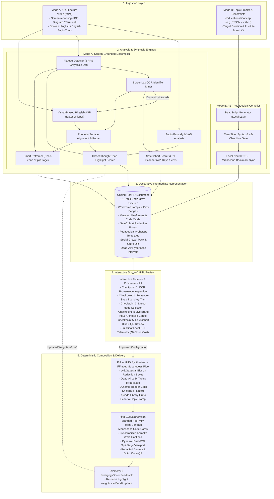
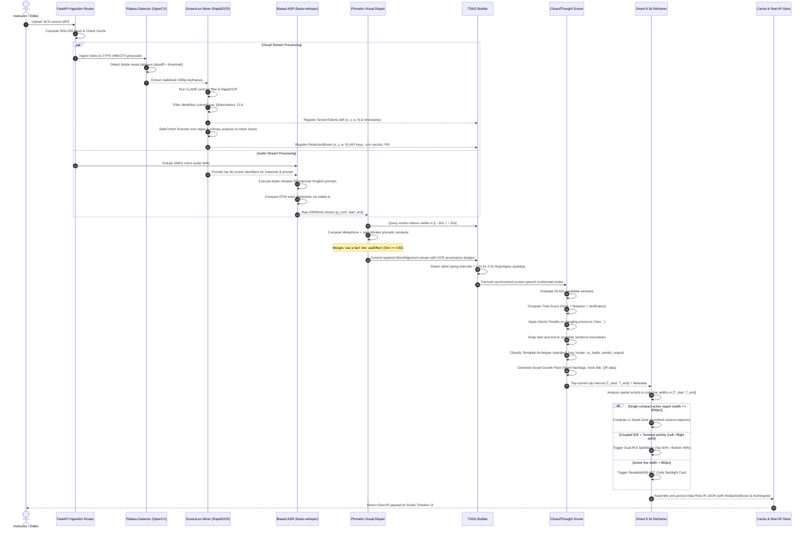
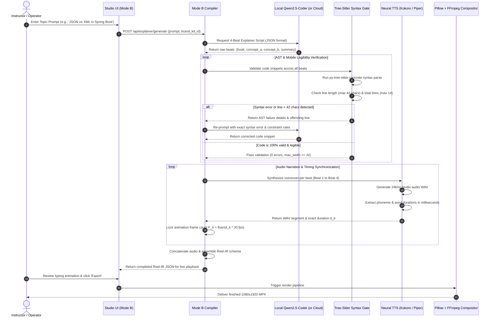
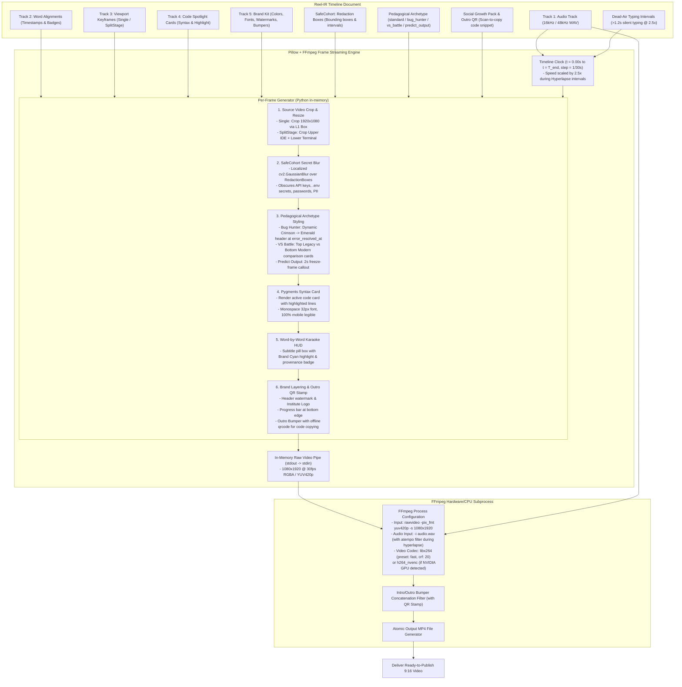
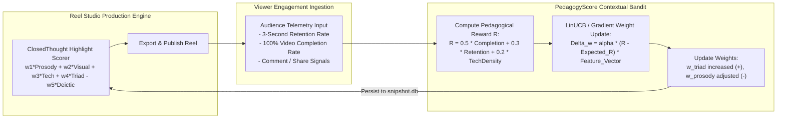

# SnipShot (Reel Studio): Operational Workflows & System Pipelines

**Document Version:** 1.0.0  
**Status:** Approved Operational Blueprint  
**Diagram Standard:** Mermaid.js (Compatible with GitHub Markdown & Antigravity Studio)  

---

## 1. Bird's-Eye Operational Workflow

This high-level flowchart illustrates the end-to-end lifecycle of media assets inside **SnipShot**, mapping the path from raw inputs (Mode A lecture recordings or Mode B topic prompts) through the processing engines, the unified `Reel-IR` bridge, the interactive Studio, and final video composition.

---

## 2. Mode A Pipeline: Screen-Grounded Decompiler

Mode A processes an unedited 16:9 lecture video into complete-thought 9:16 educational clips. The sequence diagram below shows how the visual screen stream and audio stream interact through the **Time-Aligned Screen-Speech Graph (TSSG)**.

---

## 3. Mode B Pipeline: AST-Verified Pedagogical Compiler

Mode B compiles an educational topic prompt into a high-trust, syntax-validated 9:16 code explainer reel. The pipeline enforces a strict AST gate to ensure that no broken code or illegible lines ever reach production.

---

## 4. Video Rendering & Composition Pipeline

This flowchart details how the declarative 5-track `Reel-IR` document is transformed into a broadcast-quality 1080×1920 MP4 video without using heavy browser-based tools.

---

## 5. Human-in-the-Loop (HITL) Validation Checkpoints

SnipShot integrates five explicit validation checkpoints where the instructor or editor can inspect, adjust, and approve AI-generated choices before video export.

```mermaid
stateDiagram-v2
    [*] --> IngestionComplete: Raw Video Processed into TSSG
    
    state IngestionComplete {
        [*] --> CandidateReview
        CandidateReview: 3 Candidate Clips Presented with Triad Scores
    }

    IngestionComplete --> Checkpoint1: Select Candidate Clip

    state Checkpoint1 {
        [*] --> InspectTranscript
        InspectTranscript: Review words highlighted with Cyan Provenance Badges
        InspectTranscript --> VerifyProof: Click Badge (e.g. 'useEffect')
        VerifyProof: View side-by-side comparison:\n- Raw ASR: 'use a fact' (p=0.48)\n- OCR Match: 'useEffect' (sim=0.91)\n- Cropped IDE Pixel Proof
        VerifyProof --> ManualOverride: Disapprove correction?
        ManualOverride: Type custom replacement or revert to raw
        ManualOverride --> InspectTranscript
        VerifyProof --> TermApproved: Approve correction
    }

    Checkpoint1 --> Checkpoint2: Proceed to Boundary Review

    state Checkpoint2 {
        [*] --> ScrubWaveform
        ScrubWaveform: Inspect audio waveform on WaveSurfer track
        ScrubWaveform --> DragHandles: Drag Start / End Boundary Handles
        DragHandles: Handles automatically snap to complete sentence boundaries
        DragHandles --> ValidateClosure: System checks Deictic Entry and Terminal Output
    }

    Checkpoint2 --> Checkpoint3: Proceed to Layout Review

    state Checkpoint3 {
        [*] --> InspectLayout
        InspectLayout: Preview 9:16 frame in Studio Canvas
        InspectLayout --> SwitchMode: Override AI layout decision
        SwitchMode: Toggle between:\n1. Damped Single Focus\n2. Dual-ROI SplitStage\n3. AST Code Spotlight Card
    }

    Checkpoint3 --> Checkpoint4: Proceed to Brand & Archetype

    state Checkpoint4 {
        [*] --> ApplyBrandKit
        ApplyBrandKit: Select Institute Brand Kit\n(Colors, Fonts, Watermark, Outro)
        ApplyBrandKit --> SelectArchetype: Pick Pedagogical Archetype\n(Standard, Bug Hunter, VS Battle, Predict Output)
        SelectArchetype --> ArchetypePreview: Preview dynamic color shifts or split cards
    }

    Checkpoint4 --> Checkpoint5: Proceed to Security & Growth Pack

    state Checkpoint5 {
        [*] --> SafeCohortReview
        SafeCohortReview: Inspect detected secrets (API keys, .env, PII)\nToggle Gaussian blur boxes on/off
        SafeCohortReview --> GrowthPackReview: Inspect SEO hook, tiered hashtags & Outro QR Code
        GrowthPackReview --> LocalROITelemetry: View SnipShot Local ROI Telemetry\n(₹0.00 Cloud Cost, Credits Saved, 100% On-Device Privacy)
        LocalROITelemetry --> FastPreview: Fast Sub-10s Preview Re-Render
        FastPreview --> ExportFinal: Approve for Final 1080x1920 MP4 Export
    }

    Checkpoint5 --> [*]: Video Downloaded / Scheduled
```

---

## 6. Error Handling & Fallback Decision Matrix

This flowchart details how the system gracefully handles real-world edge cases (dark themes, high CPU load, Hinglish script drift, LLM timeouts, and exposed secrets) without failing or producing corrupted outputs.

```mermaid
flowchart TD
    subgraph EdgeCase1["Edge Case 1: Dark-Theme / Low-Contrast IDE OCR"]
        E1_In["Plateau Frame Received"] --> E1_Check{"OCR Confidence < 0.60 or 0 tokens found?"}
        E1_Check -- No --> E1_Normal["Proceed with standard RapidOCR tokens"]
        E1_Check -- Yes --> E1_Filter["Apply OpenCV Inversion + CLAHE Filter\n(Contrast Limited Adaptive Histogram Equalization)"]
        E1_Filter --> E1_Retry["Re-run RapidOCR on pre-filtered frame"]
        E1_Retry --> E1_Eval{"Tokens recovered?"}
        E1_Eval -- Yes --> E1_Normal
        E1_Eval -- No --> E1_Glossary["Fall back to Base Domain Glossary (tech_glossary.json)\n(2,000+ curated CS terms)"]
    end

    subgraph EdgeCase2["Edge Case 2: Hinglish Script Alternation in Whisper"]
        E2_In["Raw ASR Word Stream"] --> E2_Check{"Contains mixed Devanagari script?"}
        E2_Check -- No --> E2_Clean["Romanized Hinglish stream confirmed"]
        E2_Check -- Yes --> E2_Translit["Run Deterministic Indic-Transliteration\n(Convert Devanagari tokens to Romanized Hinglish)"]
        E2_Translit --> E2_Case["Enforce Technical Casing Rule\n(Restore camelCase / PascalCase for identifiers)"]
        E2_Case --> E2_Clean
    end

    subgraph EdgeCase3["Edge Case 3: Memory Constraint on 8GB / 16GB CPU Laptop"]
        E3_In["Pipeline Stage Transition"] --> E3_Monitor{"Host Available RAM < 2.5 GB?"}
        E3_Monitor -- No --> E3_Continue["Proceed with default parallel execution"]
        E3_Monitor -- Yes --> E3_Seq["Trigger Sequential Memory Management:"]
        E3_Seq --> E3_U1["1. Unload RapidOCR ONNX session & run gc.collect()"]
        E3_Seq --> E3_U2["2. Run faster-whisper int8 transcription"]
        E3_Seq --> E3_U3["3. Delete Whisper model object & run gc.collect()"]
        E3_Seq --> E3_U4["4. Execute LLM / Heuristic scoring in isolated memory"]
        E3_U4 --> E3_Safe["Zero OOM Crashes Guaranteed"]
    end

    subgraph EdgeCase4["Edge Case 4: Mode B LLM Offline or Generation Timeout"]
        E4_In["Mode B Prompt Submitted"] --> E4_Timeout{"LLM response takes > 20s or connection error?"}
        E4_Timeout -- No --> E4_Success["Use LLM-generated beat script"]
        E4_Timeout -- Yes --> E4_Fallback["Activate Deterministic AST Template Engine"]
        E4_Fallback --> E4_Build["Construct validated comparison layout from template library\n(Pre-validated syntax & 42-char layout)"]
        E4_Build --> E4_Success
    end

    subgraph EdgeCase5["Edge Case 5: Accidental Secret or PII Leak in Screen Recording"]
        E5_In["Extracted OCR Tokens"] --> E5_Scan{"Matches secret regex (sk-, AWS, password, .env) or high Shannon entropy?"}
        E5_Scan -- No --> E5_Pass["Mark frame tokens safe"]
        E5_Scan -- Yes --> E5_Redact["Register RedactionBox with coordinates [x, y, w, h] in ReelIR"]
        E5_Redact --> E5_Blur["Compositor applies cv2.GaussianBlur over bounding box across visible interval"]
        E5_Blur --> E5_Alert["Display SafeCohort active shield badge in Studio UI & Telemetry"]
    end
```

---

## 7. Telemetry & Continuous Optimization Feedback Loop

To continuously improve highlight selection accuracy, SnipShot includes a lightweight `PedagogyScore` feedback loop powered by a contextual bandit algorithm.

